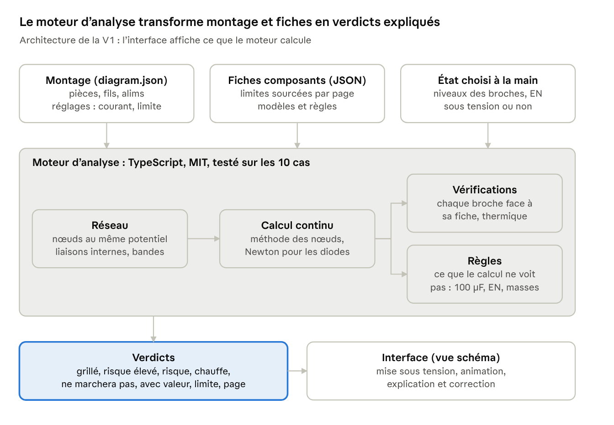

# Simulateur de breadboard — étude, fiches et plan de V1

19/11/2026 · Jean Alaniou

> **Mise à jour du 19/11/2026.** Jean veut dès la V1 un plan de travail 2D interactif : composants dessinés avec leurs broches, breadboard, fils tracés à la souris, multimètre, mise sous tension. Il remplace la « vue schéma ». Le moteur d'analyse ne change pas ; le plan passe de 7 à 9 étapes et d'environ 36 h à environ 55 h. Les sections « En bref », « Recommandation », « Plan de V1 » et « Prochaines étapes » sont réécrites en conséquence.

## En bref

Pour la V1, on ne forke pas Velxio. On écrit notre propre moteur d'analyse en TypeScript : fiches composants, calcul électrique et règles. Il sera publié sous licence MIT sur GitHub Pages. Velxio reste la cible d'intégration pour la V2.

- **Contexte retenu** : au moins 8 h par semaine, code public, notions de TypeScript. Le moteur doit vérifier le montage avant le câblage de la base (environ quatre semaines) ; l'éditeur 2D vient juste après.
- **Pourquoi pas de fork** : les 10 cas reposent sur des fiches et des règles qu'aucun outil existant ne possède. Velxio est un gros projet : à mon estimation, on passerait la moitié du mois à le comprendre.
- **Interface de la V1** : un plan de travail 2D dans l'esprit de Wokwi. On pose les composants, avec ou sans breadboard, on trace les fils, on met sous tension et on mesure au multimètre ; chaque pièce affiche son verdict. Le montage est un fichier diagram.json, le format de Wokwi, qui garde déjà la position des pièces et le trajet des fils. La 3D viendra après la V1.
- **Calcul** : méthode des nœuds écrite par nous, en régime continu. ngspice arrive en V2, pour les pics brefs.
- **Deux cas de test à reformuler** pour respecter ta règle « risque, pas grillé » : le cas 3 (débranchement à chaud) et le cas 2 (inversion VM/GND). Détails dans « Limites de la V1 ».
- **Bloquant** : la marque exacte de tes modules TMC2209 (la datasheet est récupérée).

## Étude de l'existant

Velxio est le seul outil open source qui mélange déjà émulation du code et calcul électrique. Aucun outil ne compare chaque broche à une limite sourcée dans une datasheet, et aucun n'explique en détail pourquoi un composant casse.

| Outil | Ce qui marche bien | Ce qui manque pour nous | Ce qu'on reprend |
| --- | --- | --- | --- |
| [Velxio](https://github.com/davidmonterocrespo24/velxio) (AGPLv3, ou licence commerciale) | Exécute le vrai code (Arduino, ESP32, Pico). Couche électrique [SPICE](https://velxio.dev/docs/instruments/analog-simulation/) qui montre tensions, courants et courts-circuits. Plus de 150 composants. Vérificateur qui bloque les montages qui abîmeraient de vraies pièces, par exemple une LED sans résistance. Très actif : 2,7 k étoiles, 1 626 commits. | Pas de fiche par broche avec des maxima sourcés. Pas de TMC2209 annoncé. L'ESP32 tourne sur le serveur (QEMU) : un fork complet en ligne demande un serveur. Gros code TypeScript + Python. Contributions soumises à un CLA. L'auteur [travaille encore](https://forum.arduino.cc/t/velxio-an-open-source-arduino-rp2040-emulator-running-entirely-in-the-browser/1434847) sur les limites de courant et la casse. | Ses idées d'interface (vérification avant lancement, badge SPICE). À terme, l'intégration de notre moteur. |
| Wokwi (code fermé, bibliothèques MIT) | Meilleure émulation du code ESP32 et Arduino. Format [diagram.json](https://docs.wokwi.com/diagram-format) documenté. Dessins [wokwi-elements](https://github.com/wokwi/wokwi-elements) sous MIT. | L'électricité n'est pas simulée. Sa doc de l'[A4988](https://docs.wokwi.com/parts/wokwi-a4988) indique que VMOT ne sert pas dans la simulation. Pas de TMC2209. | Le format diagram.json (import/export), les dessins, et Wokwi lui-même pour tester le code. |
| [EEcircuit / eecircuit-engine](https://github.com/eelab-dev/EEcircuit-engine) (MIT) | ngspice complet dans le navigateur, avec une API simple (start, setNetList, runSim). C'est le moteur qu'utilise Velxio. | Aucune interface de montage, aucun module de robotique. Il faut lui écrire les circuits en langage SPICE, avec un modèle par composant. | Moteur des phénomènes brefs en V2. |
| [CircuitJS](https://lushprojects.com/circuitjs/) (GPLv2) | Simulation dans le temps, par pas de 5 µs par défaut. Courants animés très parlants. | Composants idéaux : une source fournit un courant infini si on la laisse faire. Pas d'ESP32 ni de driver, pas de casse. Code Java converti par GWT, difficile à intégrer. Reprendre son code impose la GPL. | L'idée d'animer le courant et de colorer les fils selon la tension. |
| Tinkercad Circuits (code fermé) | Alerte posée sur le composant, avec la valeur et la limite (LED au-delà de 20 mA). Un débutant comprend tout de suite. | Ni ESP32, ni driver pas-à-pas. Rien à réutiliser en code. | L'expérience : le verdict s'affiche sur la pièce, avec la valeur, la limite et la correction. |

Quatre termes du tableau :

- **SPICE** : famille de logiciels de référence, née à Berkeley, qui calcule tensions et courants, y compris au cours du temps. ngspice en est la version libre.
- **WebAssembly (WASM)** : format qui fait tourner dans le navigateur du code compilé (ici le C de ngspice), presque à vitesse native.
- **QEMU** : émulateur de processeur. Velxio l'exécute sur son serveur pour faire tourner le vrai programme de l'ESP32.
- **CLA** (accord de contribution) : document à signer avant qu'une contribution soit acceptée. Il permet à l'auteur de redistribuer ton code aussi sous sa licence commerciale.

## Recommandation : notre moteur d'abord, Velxio en V2

Pour la V1, on part de zéro, sur des briques MIT. On décide entre forker Velxio et faire notre propre éditeur à la fin de la V1, pas maintenant.

1. **Ce qui a de la valeur, ce sont les fiches et les règles, pas l'éditeur.** Aucun outil étudié n'a de limite sourcée par broche. Ce moteur peut vivre sans interface et se tester automatiquement sur les 10 cas.
2. **Le délai.** Tu as moins d'un mois, soit 35 à 40 h de travail. Forker Velxio, c'est d'abord comprendre 1 626 commits en TypeScript et en Python. Ensuite, il faudrait brancher les fiches dans sa génération de circuits SPICE. Je l'estime à la moitié du temps disponible avant le premier verdict.
3. **L'hébergement.** Un fork complet a besoin d'un serveur pour la compilation et QEMU. Notre V1 est un site statique : GitHub Pages, gratuit, sans serveur.
4. **Le bon modèle n'est pas SPICE seul.** Un driver qui règle le courant de ses bobines se décrit mieux par un comportement que par ses transistors. Il consomme une puissance sur VM et impose un courant aux bobines. On maîtrise mieux ça dans notre propre solveur.
5. **On garde la porte ouverte.** Du code MIT peut entrer tel quel dans un fork AGPL de Velxio, ou lui être proposé. On lit et on écrit du diagram.json, donc un montage passe d'un outil à l'autre.

Mise à jour du 19/11/2026 : tu veux l'éditeur en glisser-déposer dès la V1. On le construit nous-mêmes, après le moteur. Toutes les pièces sont dessinées en SVG maison (breadboard, ESP32 à 38 broches, module TMC2209, moteur, résistance, alim, LiPo, condensateur) ; [wokwi-elements](https://github.com/wokwi/wokwi-elements) (MIT) reste une option pour plus tard. Ce qu'on perd encore en V1 : l'émulation du code, qui se teste dans Wokwi, et la 3D.

Critère de choix pour la V2 :

- Velxio a ajouté la casse de composants, ou accepte des fiches externes : on y contribue avec notre moteur.
- Sinon, Velxio ne sert plus qu'à une chose : émuler le code de l'ESP32. On compare alors son intégration à un simple réglage des broches à la main, qui existe déjà.

Licences : MIT = libre avec mention de l'auteur. GPL et AGPL obligent à publier le code dérivé sous la même licence ; l'AGPL l'impose aussi pour un site en ligne. Notre code étant public, l'AGPL d'un éventuel fork ne te gênerait pas.

### Architecture retenue



Les règles lisent aussi le réseau et les fiches directement : les cas 3 à 8 n'ont pas besoin du calcul.

Mise à jour : la case « Interface (vue schéma) » du dessin devient le plan de travail 2D. Il produit le montage (diagram.json) quand on place les pièces et trace les fils, puis il interroge le moteur pour les verdicts et pour le multimètre. Le moteur ne dépend pas de l'interface : la 3D pourra la remplacer sans y toucher.

## Format d'une fiche composant

Chaque composant a un fichier JSON, `fiches/<id>.json`. Chaque nombre y porte sa source, et un validateur refuse toute fiche qui contient un nombre nu. Ce validateur est un JSON Schema : un fichier qui décrit les champs permis et que des bibliothèques savent vérifier automatiquement. Le schéma est joint : `fiche-composant.schema.json`. Il est testé : un exemple valide passe, et 10 exemples fautifs sont refusés.

Sept principes :

1. **Une valeur = valeur + unité + source.** La source est l'un de quatre types. `datasheet` donne le document, la page du PDF et le tableau. `mesure` dit qui a mesuré, quand et comment. `hypothese` est justifiée et affichée comme telle. `heritee` renvoie à une autre fiche.
2. **Maxima absolus et conditions recommandées sont deux champs distincts.** Les maxima absolus ne doivent jamais être dépassés, même un instant, sous peine de dégâts. Les conditions recommandées sont la plage où le fabricant garantit le fonctionnement. Dépasser les premiers donne « grillé » ou « risque » ; sortir des secondes donne « ne marchera pas ».
3. **La puce et le module sont deux fiches.** La datasheet du TMC2209 décrit la puce. Ton module ajoute ses propres broches, une résistance de mesure du courant, un potentiomètre et des liaisons internes (les deux GND reliés). Chaque broche du module pointe vers sa broche de puce (`"vers": "U1.VS"`) et en hérite les limites.
4. **Chaque broche dit tout ce dont les règles ont besoin.** On y trouve son rôle, sa masse de référence, ses seuils logiques et son modèle électrique. On y trouve aussi ce qu'elle sait faire (IO34 : `"sortie": false`) et son état au démarrage (pour le cas EN flottant).
5. **Un modèle de comportement par type de composant.** Pas de transistors : le driver est décrit par sa consommation sur VM, le courant qu'il impose aux bobines et sa résistance interne. Le moteur de calcul connaît une liste fermée de types (`driver_pas_a_pas`, `alim_laboratoire`, `batterie`, `contact`…).
6. **Les règles sont déclarées dans la fiche.** Exemple : condensateur d'au moins 100 µF entre VM et GND. Chaque règle porte son verdict, son explication, sa correction et sa source. Le code de la règle vit dans le moteur ; ses chiffres vivent dans la fiche.
7. **Une fiche est « brouillon » tant que tu ne l'as pas relue.** Je l'extrais de la datasheet ; tu la relis et passes son statut à « relue », avec ton nom et la date. Un verdict fondé sur une fiche brouillon est signalé comme tel dans l'appli.

Extrait de forme pour une broche du module TMC2209. Les valeurs et les pages seront remplies depuis la datasheet ; les « ? » ne sont pas des données.

```json
{
  "nom": "VM",
  "role": "alim_entree",
  "vers": "U1.VS",
  "domaine": { "masse": "GND" },
  "max_absolus": {
    "tension": { "min": "?", "max": "?", "unite": "V",
      "src": { "type": "datasheet", "doc": "tmc2209-ds", "page": "?", "ou": "Absolute Maximum Ratings" } }
  },
  "recommande": {
    "tension": { "min": "?", "max": "?", "unite": "V",
      "src": { "type": "datasheet", "doc": "tmc2209-ds", "page": "?", "ou": "Operational Range" } }
  }
}
```

Les cinq verdicts, du plus grave au moins grave. Un verdict « grillé » ne sort jamais d'une règle seule.

| Verdict | Quand | D'où il vient | Exemple |
| --- | --- | --- | --- |
| Grillé | Une limite absolue est dépassée, et la source peut fournir assez de courant pour détruire | Calcul | 12 V sans résistance sur IO32 |
| Risque élevé | Cause de casse documentée, dont l'issue dépend de ce qu'on ne simule pas | Règle, ou calcul sans donnée de courant | Moteur débranché sous tension |
| Risque | Comportement dangereux possible, sans casse | Règle | EN qui flotte au démarrage |
| Chauffe | Courant ou puissance au-delà du nominal | Calcul et estimation thermique | 1,2 A dans un contact |
| Ne marchera pas | Fonctionnement impossible ou faux | Calcul ou règle | STEP sur IO34 |

Chaque verdict affiche le composant, la broche, la valeur calculée, la limite, la page source, l'explication et la correction. Il dit aussi s'il vient d'un calcul ou d'une règle.

## Fiche TMC2209 : en attente de la datasheet

> Mise à jour du 19/11/2026 : fiches `tmc2209` et `tmc2209-module` faites (brouillon) depuis la datasheet rév. 1.08 et le schéma du module BIGTREETECH V1.2. 29 V est le haut de la plage de fonctionnement ; le maximum absolu de VS est 32 V (p. 75).

La fiche n'est pas faite : la datasheet n'était pas jointe. Je refuse de citer des pages de mémoire. Dès réception du PDF, je produis deux fiches : `tmc2209` (la puce) et `tmc2209-module` (ta carte).

Ce dont j'ai besoin :

- [ ] Le PDF officiel de la datasheet TMC2209 (Analog Devices / Trinamic), avec sa révision.
- [ ] La marque et la version de tes modules à radiateur bleu (BIGTREETECH, FYSETC, MKS, générique…). Sinon, une photo nette des deux faces : elle donne l'ordre des broches et la valeur de la résistance de mesure.
- [ ] Si le vendeur en publie un, le schéma du module (liaisons internes, tirages sur MS1, MS2 et EN).

Points que je vérifierai dans la datasheet, parce qu'ils changent des verdicts :

- **Le chiffre de 29 V.** Ton schéma de la base roulante le donne comme « maximum absolu ». Il faut vérifier s'il s'agit du maximum absolu ou du haut de la plage de fonctionnement. C'est important pour la LiPo 4S : elle monte à 16,8 V chargée, et un pic au branchement peut approcher le double. La marge dépend de ce chiffre.
- **La tension inverse permise sur VS.** C'est la base du cas 2 (inversion VM/GND).
- **Le courant maximal des sorties**, en valeur efficace et en crête, et la formule qui relie la tension de réglage (Vref) au courant, avec la résistance de mesure du module.
- **La table MS1/MS2 → micro-pas**, et l'existence de tirages internes sur MS1, MS2 et EN. Ton schéma suppose que MS1/MS2 débranchées valent 0 : c'est à vérifier.
- **Les seuils thermiques** (pré-alerte, coupure) et la résistance thermique du boîtier.
- **Le condensateur recommandé sur VS** (valeur et placement), et toute mise en garde sur le branchement du moteur sous tension. Ce sont les sources des cas 3 et 4.

Les autres fiches de la V1 et leur source :

| Fiche | Document nécessaire | Pour quels cas |
| --- | --- | --- |
| ESP32 Keyestudio 38 broches | Datasheet ESP32 d'Espressif + schéma DevKitC (ou celui de Keyestudio) | 1, 5, 6, 8 |
| 17HS4401 | Fiche technique du vendeur du moteur | 10 |
| Breadboard | Fiche du fabricant si elle existe, sinon hypothèse justifiée (environ 1 A par contact) | 9 |
| Alim de labo, LiPo 4S | Réglages donnés dans le montage (tension, limite de courant) | 2, 9 |
| Condensateur, résistance, fil Dupont | Valeurs données dans le montage | 4, 5 |

## Plan de V1

Neuf étapes, environ 55 h, sur six à sept semaines à partir du 19 novembre (réécrit le même jour pour le plan de travail 2D). Chaque étape se termine par un test qu'on peut relancer. Les 10 cas deviennent 11 fichiers de montage (le cas 2 en donne deux), vérifiés automatiquement à chaque modification du code.

Le moteur (étapes 1, 2, 3, 5, 6) est inchangé. L'éditeur ajoute trois étapes : l'affichage 2D tôt (4), pour voir le montage dès que le réseau existe, puis l'édition (7) et la mise sous tension avec le multimètre (8). Vers la fin de la quatrième semaine, le moteur vérifie déjà ton vrai montage en ligne de commande.

1. **Socle** (environ 2 h, semaine 1, fait le 19/11/2026). Dépôt GitHub public sous licence MIT, avec Vite, TypeScript et Vitest, et une mise en ligne automatique sur GitHub Pages.
   - Vite construit et sert l'appli web ; Vitest lance les tests automatiques.
   - La CI (intégration continue) : GitHub relance tous les tests à chaque envoi de code.
   - Test : la page en ligne s'affiche et la CI est verte.
2. **Fiches** (environ 6 h, semaine 1). Le schéma et son validateur, puis les fiches ESP32, TMC2209 (puce et module), 17HS4401, breadboard, alim de labo, LiPo 4S, condensateur, résistance et fil Dupont. Je les extrais des PDF ; tu les relis.
   - Test : toutes les fiches passent le validateur et sont au statut « relue ».
3. **Du montage au réseau** (environ 4 h, semaine 2, fait le 19/11/2026). Lecture du diagram.json et des réglages : tension et limite de courant des alims, courant réglé des drivers, niveau des broches choisi à la main. On construit les nœuds (les points du circuit au même potentiel) en tenant compte des liaisons internes des modules et des bandes du breadboard.
   - Test : sur la base roulante, les quatre EN sont sur le même nœud que IO13, et le nombre de nœuds est celui compté à la main.
4. **Affichage 2D du montage** (environ 5 h, semaine 2, fait le 19/11/2026). Chaque pièce est dessinée à la position que donne le diagram.json, avec ses broches (nom au survol) et ses fils. On ne peut pas encore modifier.
   - Toutes les pièces sont dessinées en SVG maison, qui donne aussi la position de chaque broche. wokwi-elements a été écarté pour la V1 : il ajoutait une dépendance et ne donne ses positions de broches que dans un navigateur.
   - Une pièce enfichée dans la breadboard est recalée pile sur ses trous. Survoler une broche éclaire tout son nœud.
   - Les fils sont routés automatiquement à angle droit, sans jamais se superposer, en contournant les pièces et sans passer sur un trou qui n'est pas le leur (demande de Jean). Dans l'éditeur (étape 7), un fil restera droit pendant qu'on le tire, puis sera routé ainsi quand on le lâche.
   - Test automatique : chaque broche de chaque fiche a une position sur son dessin. Test à l'œil : la base roulante s'affiche sur la page en ligne.
5. **Calcul en continu** (environ 8 h, semaine 3, fait le 19/11/2026). Méthode des nœuds : la loi des nœuds en chaque point donne un système linéaire G·V = I, qu'on résout. Les diodes ne sont pas linéaires : on linéarise et on itère avec la méthode de Newton, vue en prépa. L'alim de labo passe de « tension constante » à « courant constant » quand elle atteint sa limite.
   - Test : six circuits calculés à la main, à moins de 1 % près. Pont diviseur, LED + résistance, alim limitée en court-circuit, deux sources qui se battent, consommation d'un driver. Et 12 V à travers 10 kΩ sur une broche 3,3 V : environ 0,8 mA dans la diode de protection, soit (12 − 3,3 − 0,6) V / 10 kΩ.
   - Fait : solveur générique (`src/moteur/solveur.ts`) et traduction du montage en éléments (`src/moteur/circuit.ts`). Les fils ont la résistance de la fiche du fil Dupont, les sources changent de régime d'elles-mêmes, le driver prend sur VS la puissance de ses bobines. La base roulante se calcule en quelques dizaines de millisecondes. Premier résultat : avec les quatre modules, EN est à 2,97 V au démarrage (et non 2,3 V), au-dessus du seuil haut du TMC2209 : les drivers démarrent coupés.
6. **Vérifications, règles, verdicts** (environ 7 h, semaines 3 et 4, fait le 19/11/2026). Chaque broche est comparée à sa fiche, la température est estimée (T ≈ T ambiante + Rth × P), et les règles tournent. Chaque verdict sort avec sa valeur, sa limite, sa source, son explication et sa correction.
   - Test : les 10 montages donnent chacun le verdict attendu, sur la bonne broche.
   - Fait : `src/moteur/verifications.ts` (ce qui sort du calcul) et `src/moteur/regles.ts` (les règles des fiches), montages de cas dans `montages/cas/` produits par `outils/generer_montages.py`, commande `npm run verifier -- <montage>`. Le montage corrigé ne donne aucune alerte. Sur la base roulante proposée, seuls manquent les 4 condensateurs ; mais avec les 4 drivers actifs (VREF 1,2 V), le fil unique de l'alim porte 1,02 A, juste au-dessus du seuil de 1 A d'un fil Dupont et d'un contact de breadboard.
   - Test : le montage corrigé ne donne aucun verdict rouge. C'est le critère « zéro fausse alerte ». Corrigé veut dire : condensateurs, tirage sur EN, masse commune, MS1/MS2 identiques.
   - À la fin de cette étape, le moteur vérifie déjà ton vrai montage en ligne de commande, avant l'interface.
7. **Éditeur** (environ 12 h, semaines 5 et 6, fait le 19/11/2026). Palette de composants, pièces qu'on place et déplace, enfichage dans la breadboard (la broche s'accroche au trou le plus proche), fils tracés et supprimés à la souris (droits pendant le tracé, routés au lâcher), annulation, import et export du diagram.json.
   - Test automatique : une broche posée sur un trou est reliée à toute sa bande ; un fil tracé apparaît dans le diagram.json ; exporter puis réimporter redonne le même montage.
   - Fait : `src/ui/edition.ts` (l'éditeur, testable sans navigateur) et `src/ui/main.ts` (la page). Une pièce lâchée près des trous s'y enfiche ; une pièce qui mettrait deux broches sur la même bande, ou une alim, ne s'enfiche pas. Un redessin complet de la base roulante (routage des 59 fils compris) prend environ 250 ms.
8. **Mise sous tension et mesures** (environ 8 h, semaines 6 et 7, fait le 19/11/2026). Bouton « Mettre sous tension », verdict affiché sur chaque pièce et panneau d'explications. Multimètre : deux sondes donnent la tension entre deux points, un clic sur un fil donne le courant. Réglages à la main (niveaux des broches, EN, UART, VREF, tension et limite de l'alim), choix parmi les 10 scénarios. Animations : rouge et fumée pour « grillé », orange pulsé pour « chauffe ».
   - Le multimètre ne coûte presque rien : la méthode des nœuds calcule déjà la tension de chaque point et le courant de chaque fil.
   - Fait : `src/ui/affichage.ts` (mesures, marques, panneaux) et la page. Test automatique : les mesures affichées égalent celles du moteur et chaque cas marque la bonne pièce. Les 10 scénarios ont été rejoués dans le navigateur ; sur la base roulante, le multimètre lit 2,97 V sur EN et 28 mA dans le fil de l'alim, et passer IO13 en sortie basse fait apparaître les 1,02 A du fil de l'alim.
   - Test automatique : les valeurs affichées par le multimètre égalent celles du moteur. Test à la main : les 10 scénarios rejoués dans le navigateur, avec une liste à cocher.
9. **Confrontation au vrai montage** (environ 2 h, semaine 7). On mesure trois grandeurs au multimètre sur la base câblée et on les compare au calcul. Les trois grandeurs : courant sur VM moteurs activés à l'arrêt, tension sur EN au démarrage, chute de tension sur le rail VM.
   - Test : les écarts sont notés dans le README. Au-delà de 20 %, on corrige la fiche ou le modèle.

Si le temps manque, on coupe d'abord les animations, puis la mesure de courant au clic. Le moteur, les 10 tests et l'édition de base (placer, enficher, tracer les fils) sont le cœur de la V1. La 3D est hors V1.

Les 10 cas et ce qui doit les détecter :

| # | Cas | Détecté par | Verdict attendu | Étape |
| --- | --- | --- | --- | --- |
| 1 | 12 V sur une broche de l'ESP32 | Calcul : tension de broche au-delà du maximum absolu, courant dans la diode de protection | Grillé (source sans résistance) | 5, 6 |
| 2 | VM et GND inversés sur un TMC2209 | Calcul : tension inverse sur VS, courant fourni par la source | Grillé ou risque élevé selon la source (voir Limites) | 5, 6 |
| 3 | Moteur débranché avec VM alimenté | Règle : fil de bobine retiré pendant que VM est sous tension | Risque élevé (voir Limites) | 6 |
| 4 | Pas de 100 µF près d'un driver | Règle : condensateur assez gros entre VM et GND du driver, à quelques trous | Risque élevé | 6 |
| 5 | EN qui flotte au démarrage | Règle : état de démarrage de la broche ESP32 (fiche) et aucun tirage sur le nœud EN | Risque | 6 |
| 6 | STEP ou DIR sur IO34 à IO39 | Règle : broche sans capacité de sortie reliée à une entrée qui attend un signal | Ne marchera pas | 6 |
| 7 | MS1/MS2 différents d'un driver à l'autre, sans UART | Règle : micro-pas déduit des niveaux (table de la fiche), comparé entre drivers | Ne marchera pas (vitesses différentes) | 6 |
| 8 | Masses non reliées | Connexité : la masse de référence de l'émetteur et du récepteur n'est pas le même nœud | Ne marchera pas | 3, 6 |
| 9 | Plus d'environ 1 A dans un contact | Calcul : courant dans chaque contact, comparé à la fiche du breadboard | Chauffe | 5, 6 |
| 10 | Courant moteur réglé au-delà de 1,7 A | Calcul : réglage comparé au nominal du moteur ; puissance perdue dans le driver | Chauffe ; risque si la température estimée dépasse le seuil de la fiche | 5, 6 |

Une prédiction à vérifier à l'étape 9 : ton montage de référence déclenchera sans doute le cas 9. Réglé à 1 A efficace, le courant d'une bobine monte jusqu'à √2 × 1 A ≈ 1,4 A en crête. Sur tes photos, les sorties moteur passent par les contacts du breadboard.

## Limites de la V1, et deux cas à reformuler

La V1 calcule le régime établi, rien de ce qui dure une fraction de seconde. Pour chaque phénomène non simulé, une règle dit « risque » quand elle existe. Sinon, l'écran l'indique clairement : « non simulé ».

| Non simulé en V1 | Conséquence | Quand |
| --- | --- | --- |
| Pic de tension au branchement d'une alim (fils longs + condensateurs céramiques) | Couvert par la règle du condensateur 100 µF (cas 4) | V2 avec ngspice |
| Tension renvoyée par un moteur qui freine ou tourne vite | Non couvert | V2 |
| Découpage du courant par le driver (chopper) | On calcule des moyennes et des crêtes, pas la forme d'onde | V2 si utile |
| Échauffement au fil du temps | On estime la température finale seulement | V2 |
| Décharges électrostatiques, faux contacts | Non couvert | Hors projet |
| Le programme de l'ESP32 | Niveaux des broches réglés à la main ; le code se teste dans Wokwi | Plus tard |
| Vue en 3D | Le montage se voit et s'édite en 2D | Après la V1 |

**Cas 3, à reformuler : « risque élevé » au lieu de « grillé ».** Débrancher un moteur sous tension casse souvent un driver, mais pas toujours. L'issue dépend du courant dans la bobine à l'instant où le contact s'ouvre. Un calcul en continu ne peut pas le savoir. D'après ta propre règle, le verdict honnête est « risque élevé : casse fréquente, ne jamais le faire ».

**Cas 2, à découper selon la source.**

- **2a, LiPo 4S** : aucune limite de courant, des dizaines d'ampères disponibles. Le verdict attendu est « grillé », avec un risque d'incendie signalé.
- **2b, alim de labo limitée à 1 A** : le courant est borné et le driver peut survivre. Le verdict attendu est « risque élevé ». Le seuil exact viendra du courant maximal de la fiche.

Un détail que seul le calcul voit : si un seul driver est inversé et les trois autres sont bien câblés, le GND du driver inversé reçoit le + de l'alim. Comme ses deux GND sont reliés sur le module, il met le + en court-circuit avec la masse commune. Le calcul doit trouver ce court-circuit franc, en plus de la tension inverse.

## Prochaines étapes

Mis à jour le 19/11/2026.

- [x] Toi : valider les deux reformulations (cas 2 découpé en 2a/2b, cas 3 en « risque élevé »).
- [x] Toi : choisir le dépôt (`Simbadlemarin78/simulateur-breadboard`) et autoriser le push.
- [x] Moi : étape 1 (socle), en ligne sur GitHub Pages.
- [x] Moi : fiches TMC2209 (puce et module, datasheet rév. 1.08) et 17HS4401 (pages web concordantes), en brouillon.
- [x] Toi : choisir l'interface de la V1 : plan de travail 2D interactif.
- [ ] Toi : la marque de tes modules TMC2209, ou mesurer au multimètre la résistance entre EN et VDD (20 kΩ sur le modèle BIGTREETECH).
- [ ] Toi : le nom gravé sur le capot du module de ta carte ESP32 (WROOM-32, 32D ou 32E).
- [ ] Toi : relire les fiches et les passer à « relue ».
- [x] Moi : fiches ESP32 (puce `esp32` et carte `esp32-devkitc`, noms de broches de Wokwi), en brouillon, et un test de cohérence entre fiches.
- [ ] Toi : valider le seuil de « grillé » du cas 1 : Espressif ne publie aucune limite de courant d'injection, j'ai pris les 200 mA de l'essai de latch-up (hypothèse).
- [x] Moi : fiches breadboard, alim de labo, LiPo 4S, condensateur, résistance et fil Dupont, en brouillon (les 11 fiches de l'étape 2 sont écrites).
- [ ] Toi : vérifier sur ton matériel la breadboard (nombre de colonnes, rails coupés au milieu ou non), le modèle de ton alim et la capacité de ta LiPo.
- [x] Moi : étape 5 (calcul en continu), avec de nouvelles valeurs en brouillon dans les fiches : diodes de protection et du pont, consommation de l'ESP32 et du TMC2209, pleine échelle de VREF, résistance de mesure du module.
- [x] Moi : étape 8 (mise sous tension, verdicts sur le plan, multimètre, réglages à la main, animations).
- [ ] Toi : étape 9, la confrontation au vrai montage : mesurer au multimètre le courant sur VM moteurs activés à l'arrêt, la tension de EN au démarrage et la chute de tension sur le rail VM, et comparer à ce qu'affiche l'appli.
- [x] Moi : étape 7 (éditeur) : palette, glisser-déposer avec enfichage, fils tirés à la souris, suppression, annuler et rétablir, import et export du diagram.json.
- [x] Moi : étape 6 (vérifications, règles, verdicts), avec 4 nouvelles règles en brouillon (EN au démarrage, entrée seule, surintensité de la batterie, et le réglage `courant_uart` du module).
- [ ] Toi : donner le courant de décharge continu de ta LiPo (34,84 A retenus, d'un élément MaxAmps de 670 mAh) et dire si 25 °C d'ambiante te va.
- [ ] Toi : valider les hypothèses du calcul : diodes de protection à 0,6 V sous 1 mA (note NXP AN4731), diodes du pont à 1,0 V sous 3 A (TI LMD18245), alim de labo qui n'absorbe pas de courant, ESP32 alimenté par l'USB et consommant 68 mA.

Questions encore ouvertes :

- Que veut dire « près du driver » pour le condensateur ? Retenu à l'étape 6 : enfiché sur les mêmes bandes que VM et GND du driver, ou relié à elles par un fil qui ne sert qu'à lui. Un condensateur sur le rail ne compte pas. À affiner si besoin.
- Les quatre drivers forment-ils un « groupe » déclaré dans le montage (la base roulante) ? Le cas 7 compare les micro-pas à l'intérieur d'un groupe. Retenu à l'étape 6 : un attribut `groupe` sur les modules ; sans attribut, tous les drivers sont dans le même groupe.
- Le cas 5 (EN qui flotte) : sur le module BIGTREETECH, EN est tiré vers VDD par 20 kΩ, donc un EN en l'air coupe le driver. Si tes modules sont faits pareil, le cas 5 doit se reformuler. Mais la datasheet de l'ESP32 (p. 69) montre qu'après le reset, IO13 tire vers la masse par 45 kΩ : avec les 20 kΩ d'un module, EN tombe vers 2,3 V, dans la zone indécise du TMC2209. Avec quatre modules en parallèle (5 kΩ), le calcul de l'étape 5 donne 2,97 V : au-dessus du seuil haut, drivers coupés, mais avec seulement 0,66 V de marge. Le cas 5 reste un vrai sujet, que seul le calcul voit, et sa conclusion dépend du nombre de modules et de la vraie valeur du tirage.

## Sources

Pages consultées le 19 novembre 2026 :

- [Dépôt GitHub de Velxio](https://github.com/davidmonterocrespo24/velxio) : architecture, licence double AGPLv3 / commerciale, CLA, activité.
- [Velxio, documentation de la simulation analogique](https://velxio.dev/docs/instruments/analog-simulation/) : composants modélisés, vérificateur avant lancement.
- [Annonce de Velxio sur le forum Arduino](https://forum.arduino.cc/t/velxio-an-open-source-arduino-rp2040-emulator-running-entirely-in-the-browser/1434847) : travaux sur les limites de courant et la casse, version 2.5 avec ngspice.
- [Wokwi, format diagram.json](https://docs.wokwi.com/diagram-format)
- [Wokwi, pièce A4988](https://docs.wokwi.com/parts/wokwi-a4988) : VMOT non utilisé dans la simulation.
- [wokwi-elements](https://github.com/wokwi/wokwi-elements) : licence MIT ; liste des pièces dessinées (dossier `src`) : ESP32 DevKit V1, moteur pas à pas, résistance, LED, potentiomètre..., ni breadboard ni driver pas à pas.
- [eecircuit-engine](https://github.com/eelab-dev/EEcircuit-engine) : licence MIT, API.
- [CircuitJS1](https://lushprojects.com/circuitjs/) : GPLv2, pas de temps de 5 µs, composants idéaux.
- [Schéma interactif de la base roulante](https://claude.ai/artifact/CLAxfvyscJcJFKTC59LJJ5) : broches, câblage, chiffre de 29 V à vérifier.
